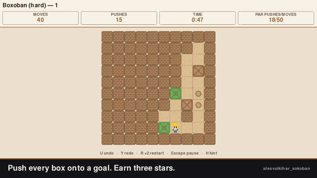
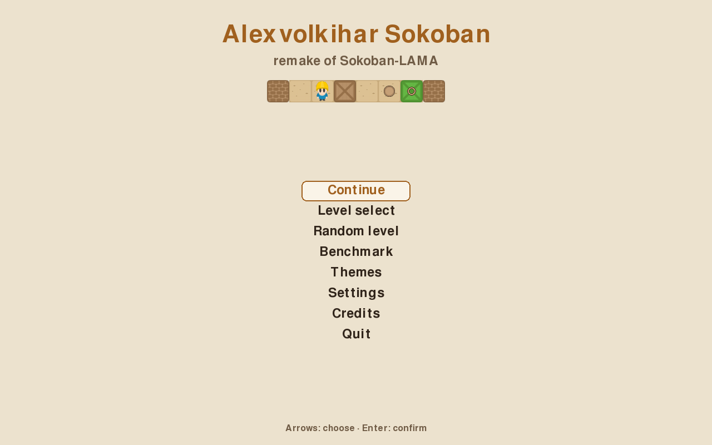
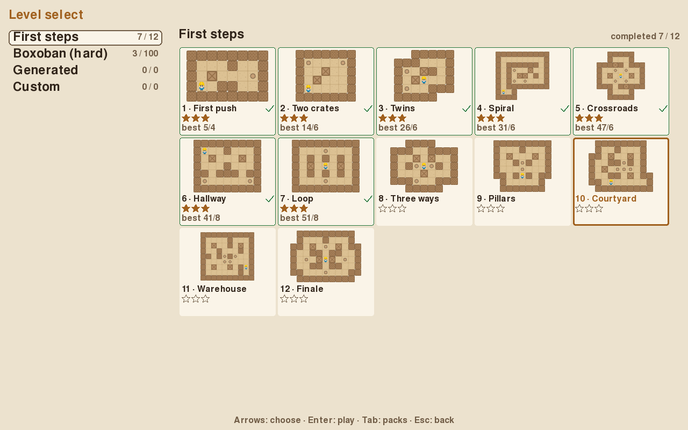
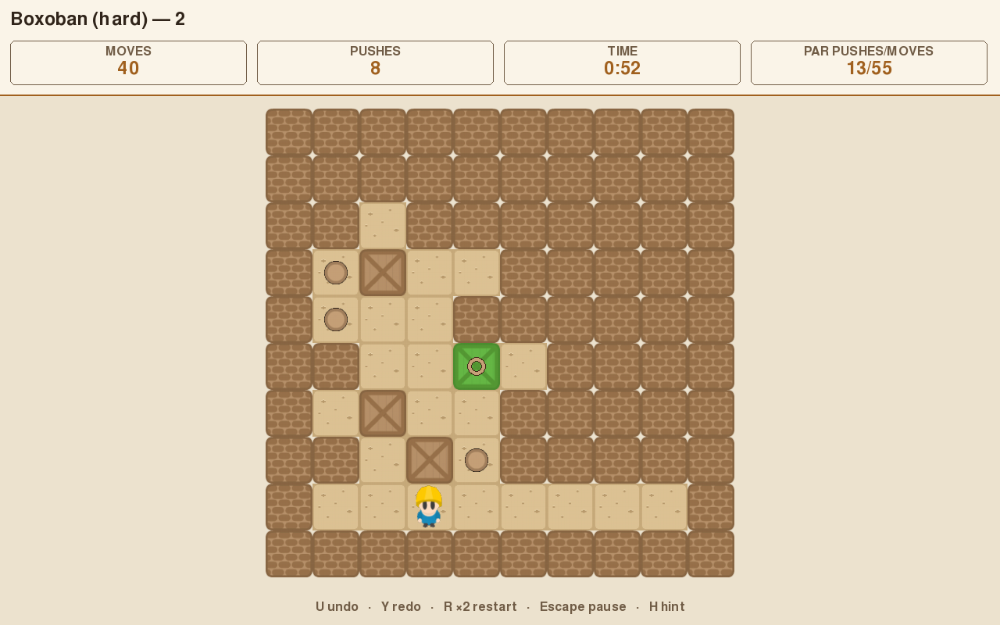
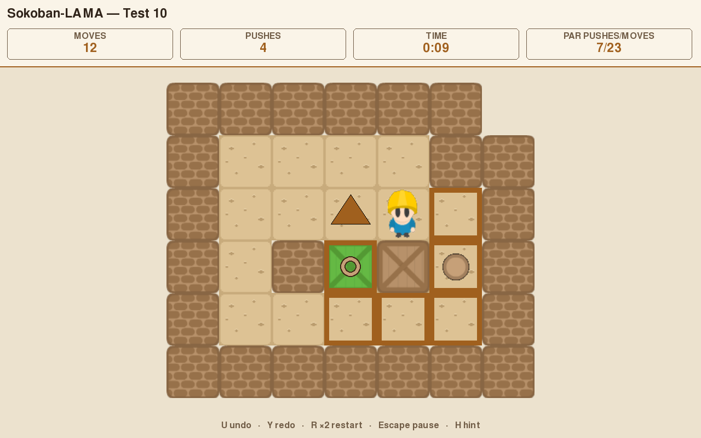
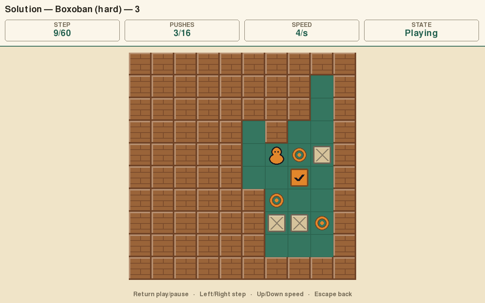
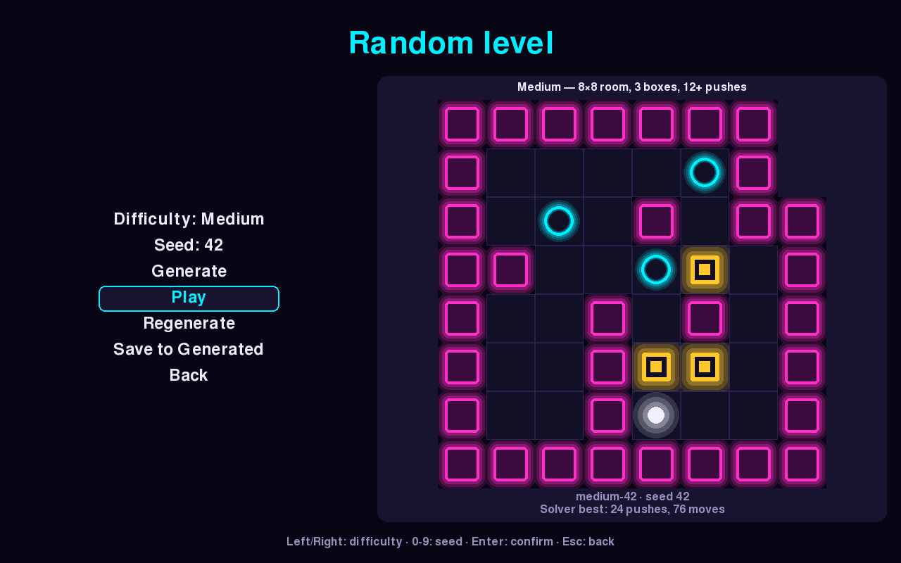
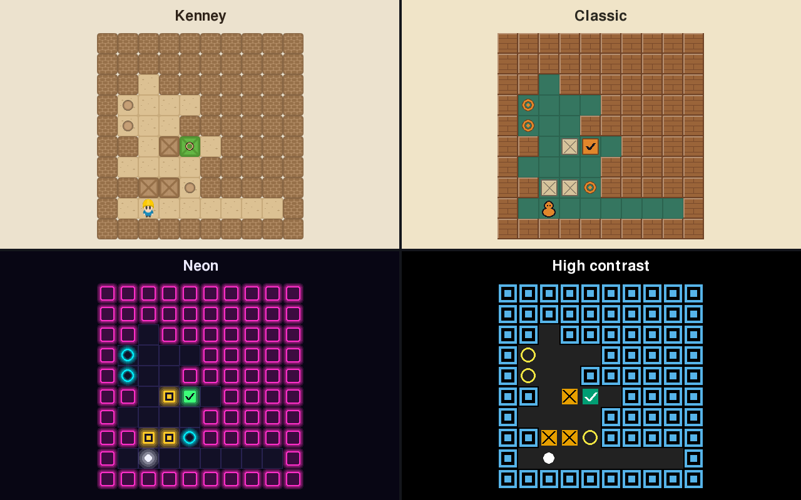
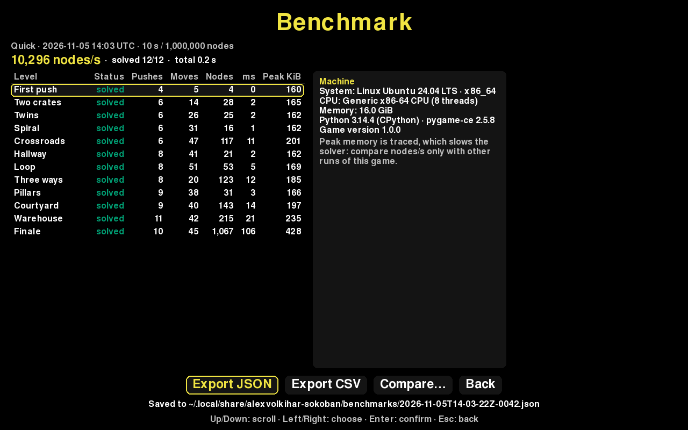
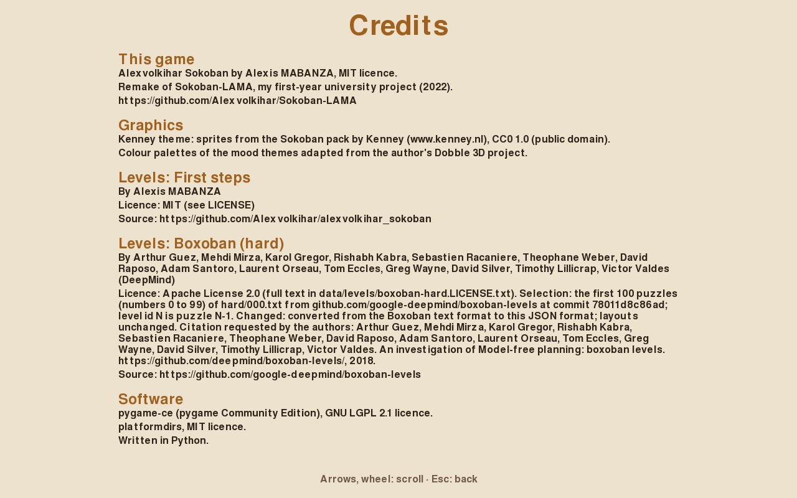

# Alexvolkihar Sokoban

*[Version française](https://github.com/Alexvolkihar/alexvolkihar_sokoban/blob/main/README.md)*

[](https://github.com/Alexvolkihar/alexvolkihar_sokoban/blob/main/docs/media/demo.mp4)

<!--
Note for the repository owner: to get an inline video player on GitHub, open this file in the github.com
editor, drag docs/media/demo.mp4 into the text area and paste here the
https://github.com/user-attachments/assets/... URL that GitHub generates (on a line of its own).
Links in this file are absolute because it is also the package's long description.
-->

[Demo video (MP4, 30 s)](https://github.com/Alexvolkihar/alexvolkihar_sokoban/blob/main/docs/media/demo.mp4)

A Sokoban game in Python and pygame-ce: push the boxes onto the goals, you can never pull them. It takes
Sokoban-LAMA, a 2022 student project, and turns it into a complete game: menus, more than 100 levels, a
solver that gives hints and sets each level's reference score, a random level generator, a benchmark mode
to compare machines, 20 themes, saves, and a French and English interface.

This project is a remake of
[Sokoban-LAMA](https://github.com/Alexvolkihar/Sokoban-LAMA), the first-year (L1) university group project
of **Antoine LAROCHE, Alexis MABANZA, Logan VIVIEN and Martin PACARY (groupe LAMA)**. The original code is
kept unchanged in [`legacy/`](https://github.com/Alexvolkihar/alexvolkihar_sokoban/tree/main/legacy/). The
other credits are at the [end of this page](#credits).

## Contents

- [Features](#features)
- [Installation](#installation)
- [Playing](#playing)
- [Levels](#levels)
- [Command line](#command-line)
- [Benchmark](#benchmark)
- [Data and saves](#data-and-saves)
- [Formats and ports](#formats-and-ports)
- [What changed since Sokoban-LAMA](#what-changed-since-sokoban-lama)
- [Development](#development)
- [Credits](#credits)
- [Licence](#licence)

## Features

The interface follows the system language on first run and can be switched in the settings.

| Main menu | Level select |
|---|---|
|  |  |
| **Continue** resumes the game in progress, moves included. | Packs on the left; thumbnails, stars and best scores (moves/pushes) on the right. |

| Game | Hint |
|---|---|
|  |  |
| Moves, pushes, time and par (the solver's score). Unlimited undo and redo. | `H` computes the next push of a solution in the background, or says the position is a dead end. |

| Solver replay | Random level |
|---|---|
|  |  |
| From the pause menu: play/pause, step by step, adjustable speed. | Three difficulties and a reproducible seed; the solver checks every level. |



20 themes: the Kenney sprites of the original game, `classic`, `neon`, `contrast` (Okabe-Ito palette and
distinct shapes: ring goals, crossed boxes, a check mark on a placed box, so nothing relies on colour alone)
and 16 mood palettes. The theme picker shows a live preview.

| Benchmark | Credits |
|---|---|
|  |  |
| The solver on a set of levels: time, nodes, memory, JSON/CSV export, comparison. | Authors, sources and licences of everything shipped with the game. |

Also: a victory screen with 1 to 3 stars, settings (language, animation speed, timer, fullscreen, progress
reset), rebindable keys, a window that resizes down to 640×480, and everything playable from the keyboard
(the mouse works in the menus).

## Installation

You need Python 3.11, 3.12, 3.13 or 3.14. The only dependencies are `pygame-ce` and `platformdirs`;
pygame-ce publishes wheels for Windows, macOS and Linux on these Python versions, so no compiler is needed.

With [pipx](https://pipx.pypa.io/) (recommended, the game gets its own environment):

```bash
pipx install git+https://github.com/Alexvolkihar/alexvolkihar_sokoban
alexvolkihar-sokoban
```

From a [GitHub release](https://github.com/Alexvolkihar/alexvolkihar_sokoban/releases): each published
version comes with a wheel and a source archive. Download the `.whl`, then:

```bash
pipx install ./alexvolkihar_sokoban-1.0.0-py3-none-any.whl
```

From source:

```bash
git clone https://github.com/Alexvolkihar/alexvolkihar_sokoban
cd alexvolkihar_sokoban
python -m venv .venv
source .venv/bin/activate        # Windows: .venv\Scripts\activate
pip install .
alexvolkihar-sokoban             # or: python -m alexvolkihar_sokoban
```

pygame-ce is imported as `pygame`, like pygame. If the `pygame` package is already installed in the same
environment, uninstall it first (`pip uninstall pygame`): the two cannot live side by side.

## Playing

`alexvolkihar-sokoban` without arguments opens the main menu. `alexvolkihar-sokoban play FILE` starts a
level straight from an XSB, SOK, JSON or original LAMA file.

| Action | Default keys |
|---|---|
| Move | Arrows, or WASD by physical position (ZQSD on an AZERTY keyboard) |
| Undo | `U`, `Backspace`, `Ctrl+Z` |
| Redo | `Y`, `Ctrl+Y` |
| Restart | `R` twice within 1.5 s |
| Hint | `H` |
| Pause | `Esc`, `P` |
| Confirm | `Enter`, `Space` |
| Back | `Esc` |

Every key can be changed in *Settings → Key bindings*. While the solution plays: `Enter` play/pause,
`←`/`→` step, `↑`/`↓` speed.

Stars are measured against the **par**, the solution with the fewest pushes the solver found: 3 stars at par
(pushes and moves), 2 stars with up to 25 % more pushes, 1 star otherwise. Finishing in fewer moves than
the par earns a badge. A game in which you asked for a hint or watched the solution counts as completed,
without stars or records.

## Levels

| Pack | Content | Authors and licence |
|---|---|---|
| Sokoban-LAMA | the 11 levels of Sokoban-LAMA (`test1` to `test11`) | the LAMA group, same licence as the code |
| Boxoban (hard) | the first 100 levels of `hard/000.txt` (10×10, 4 boxes) | DeepMind, Apache-2.0 ([licence and citation](https://github.com/Alexvolkihar/alexvolkihar_sokoban/blob/main/src/alexvolkihar_sokoban/data/levels/boxoban-hard.LICENSE.txt)) |
| Generated | the generator's levels you played or saved | yours |
| Custom | files dropped in `<data dir>/levels/` | yours |

To add your own levels, drop `.xsb`, `.sok`, `.txt` or `.json` files in the `levels/` folder of the
[data directory](#data-and-saves): they show up in the *Custom* pack. A file can hold several levels; an
invalid level gives a warning, not a crash.

Microban (David W. Skinner) is not shipped: its licence asks for the levels to be distributed unchanged,
which rules out dropping the ones borrowed from other authors or converting them. Levels `test12` to
`test14` (unsolvable on purpose) and `test_performance` are only used by the tests and the benchmark.

## Command line

Every command accepts `--data-dir PATH` (before the command name) and `--help`.

```bash
# Open the menu, or play a level from a file
alexvolkihar-sokoban play
alexvolkihar-sokoban play my-levels.sok --level 3

# Solve a level
alexvolkihar-sokoban solve legacy/level/test3.txt
alexvolkihar-sokoban solve pack.json --level 7 --time-limit 30 --max-nodes 2000000 --mode fast

# Convert between XSB/SOK, the original LAMA format and JSON (output format from the extension)
alexvolkihar-sokoban convert legacy/level/test3.txt test3.xsb

# Compute the par of every level of a JSON pack (the file is rewritten)
alexvolkihar-sokoban annotate my-pack.json --time-limit 60

# Run a benchmark, then compare two results
alexvolkihar-sokoban bench --suite standard --csv results.csv
alexvolkihar-sokoban bench compare before.json after.json

# Generate a reproducible level (XSB on standard output, or a file with --out)
alexvolkihar-sokoban generate --preset hard --seed 42 --out hard-42.xsb
```

`solve` exits with 0 when the level is solved, 1 when it is unsolvable, 2 for an unreadable file or an
unknown level, 3 when a limit is hit. Sample output:

```text
level: test3/1
status: solved
pushes: 4
moves: 25
nodes: 8 expanded, 22 generated
time: 0 ms
lurd: LrdrddrddllllUUddrrrruulD
```

## Benchmark

The benchmark has the solver work through a set of levels, one at a time, and records for each level the
outcome, pushes, moves, expanded nodes, time and peak memory. The headline figure is expanded nodes per
second.

| Suite | Levels | Limits per level |
|---|---|---|
| `quick` | the 11 LAMA levels, a few seconds | 10 s / 1,000,000 nodes |
| `standard` | LAMA and the first 40 Boxoban levels | 30 s / 3,000,000 nodes |
| `stress` | unsolvable levels, the repaired `test_performance` and all 100 Boxoban levels | 60 s / 5,000,000 nodes (limit hits are expected) |

Run it from the *Benchmark* menu or with `alexvolkihar-sokoban bench`. Each result is saved in
`<data dir>/benchmarks/` as JSON (and CSV on request). `bench compare A B` shows the time and node
differences level by level and flags status changes; the in-game screen offers the same comparison.

Peak memory is measured with `tracemalloc`, which slows the solver down: compare nodes/s between runs of
this game, not with other programs. The result describes the machine (system, CPU, memory, Python and
pygame-ce versions) but holds no host name or user name, so it can be shared. Nothing is sent anywhere.

## Data and saves

| System | Data directory |
|---|---|
| Linux | `~/.local/share/alexvolkihar-sokoban` |
| macOS | `~/Library/Application Support/alexvolkihar-sokoban` |
| Windows | `%LOCALAPPDATA%\alexvolkihar-sokoban` |

The `ALEXVOLKIHAR_SOKOBAN_HOME` environment variable or the `--data-dir` option override it. It holds
`settings.json`, `progress.json` (stars and records), `session.json` (the game in progress),
`generated.json` (generated levels), `levels/` (your levels) and `benchmarks/`.

The game in progress is saved on pause, on leaving and every 10 s. Progress is tied to a fingerprint of the
level, not to its name: renaming or reordering a pack keeps the scores. Writes are atomic; a corrupt file is
renamed `*.corrupt-<date>.json` and the game starts again from defaults instead of crashing.

## Formats and ports

A Godot remake is planned. The game rules and every file (packs, settings, progress, game in progress,
benchmark results) are described in
[`docs/formats.md`](https://github.com/Alexvolkihar/alexvolkihar_sokoban/blob/main/docs/formats.md), with
JSON Schemas in [`schemas/`](https://github.com/Alexvolkihar/alexvolkihar_sokoban/tree/main/schemas/) and
conformance vectors in
[`tests/vectors/`](https://github.com/Alexvolkihar/alexvolkihar_sokoban/tree/main/tests/vectors/), so that a
port reads the same levels and the same saves. Changes are listed in
[`CHANGELOG.md`](https://github.com/Alexvolkihar/alexvolkihar_sokoban/blob/main/CHANGELOG.md).

## What changed since Sokoban-LAMA

The original game (about 545 lines) ran a single level from the command line. Reading it again:

- Its "A\*" was not one: the priority queue always removed the first item, so the search was a
  breadth-first search over moves that kept the full path in every node and could run out of memory. The
  new solver is an A\* over pushes, with deadlock detection and time and node limits.
- The board was drawn transposed (rows and columns swapped); the solution replay made up for it by swapping
  directions. It is now drawn the right way round.
- The `*` of the LAMA format (a box) clashed with the `*` of the standard XSB format (a box on a goal). Each
  format is now read by its own rules.
- `lvlultime` was a copy of `test8`, and `test_performance` (12 boxes, 14 goals) could never be won; a
  repaired version exists for the benchmark. `wiki.txt` is level 1 of Thinking Rabbit's Sokoban (1982),
  which is not ours: it stays only in `legacy/`.
- Images were reloaded on every move and rescaled on every frame; the game now caches them.

## Development

```bash
python -m venv .venv
source .venv/bin/activate
pip install -e '.[dev]'
ruff check .
ruff format --check .
mypy
pytest -q
```

The UI tests run without a window (`SDL_VIDEODRIVER=dummy`, set by `tests/conftest.py`). Only `ui/` and
`commands/play.py` import pygame; Ruff and `tests/test_layering.py` check it. GitHub Actions runs these
checks on Linux (Python 3.11 to 3.14), Windows and macOS, then builds and tests the wheel.

The screenshots and the video in this README come from the game itself, without a window:

```bash
pip install -e '.[media]'
python scripts/capture.py --out docs/media
```

The shot list is in `scripts/storyboard.json`.

## Credits

- **Sokoban-LAMA** (2022): Antoine LAROCHE, Alexis MABANZA, Logan VIVIEN and Martin PACARY (groupe LAMA),
  <https://github.com/Alexvolkihar/Sokoban-LAMA>. The deadlock patterns of its solver were credited to
  KnightofLuna on GitHub.
- **This remake**: Alexis MABANZA.
- **Kenney theme sprites**: the "Sokoban" pack by [Kenney](https://www.kenney.nl), CC0 1.0 (public domain).
- **Mood theme palettes**: adapted from the author's Dobble 3D project.
- **Boxoban levels**: Arthur Guez, Mehdi Mirza, Karol Gregor, Rishabh Kabra, Sebastien Racaniere, Theophane
  Weber, David Raposo, Adam Santoro, Laurent Orseau, Tom Eccles, Greg Wayne, David Silver, Timothy Lillicrap
  and Victor Valdes (DeepMind), *An investigation of Model-free planning: boxoban levels*, 2018,
  <https://github.com/google-deepmind/boxoban-levels>, Apache-2.0 licence.
- **Libraries**: [pygame-ce](https://pyga.me/) (LGPL-2.1) and
  [platformdirs](https://github.com/tox-dev/platformdirs) (MIT).

## Licence

Not licensed yet: the licence awaits the agreement of the original co-authors. Until then, all rights are
reserved. The Kenney sprites (CC0) and the Boxoban levels (Apache-2.0) keep their own licences.
