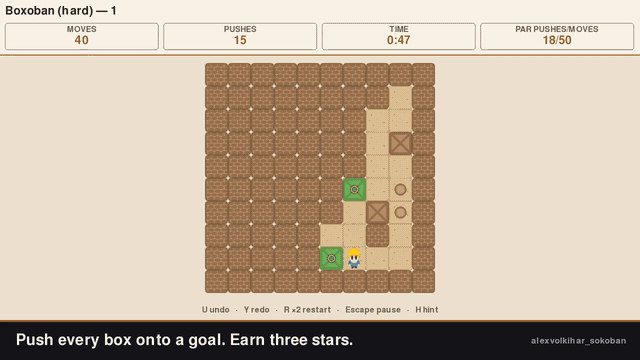
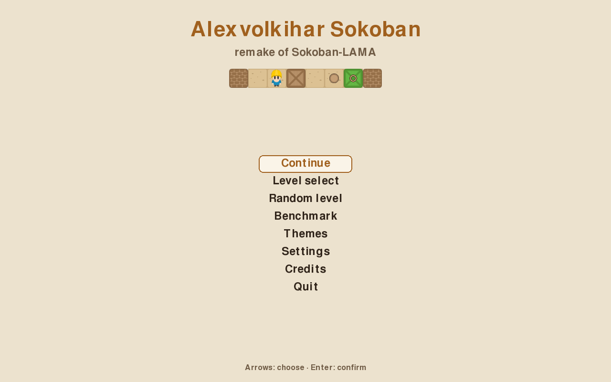
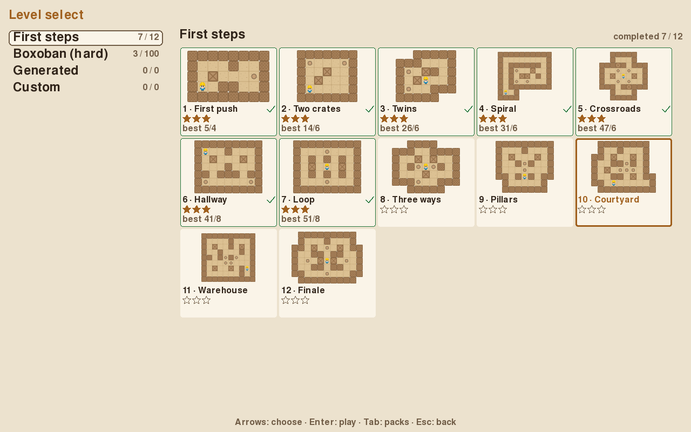
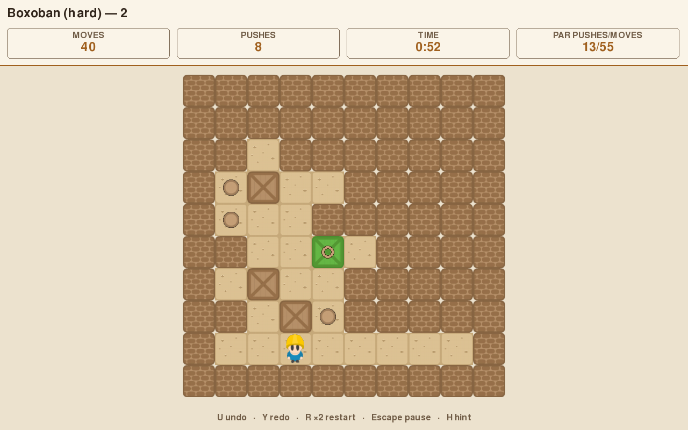
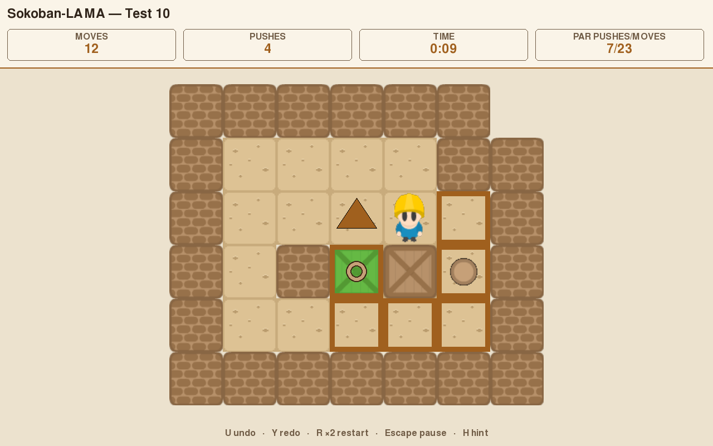
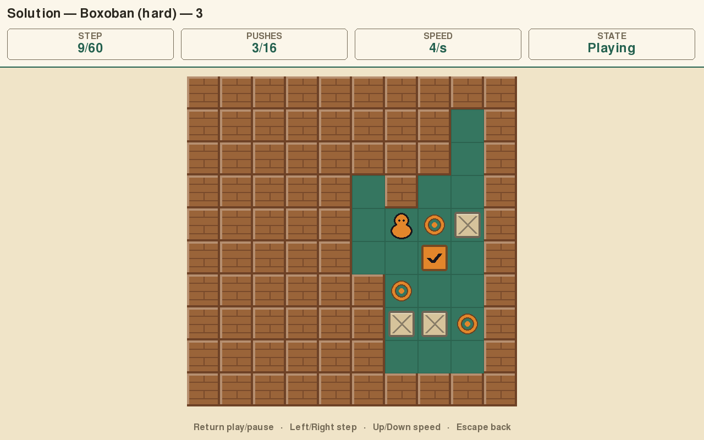
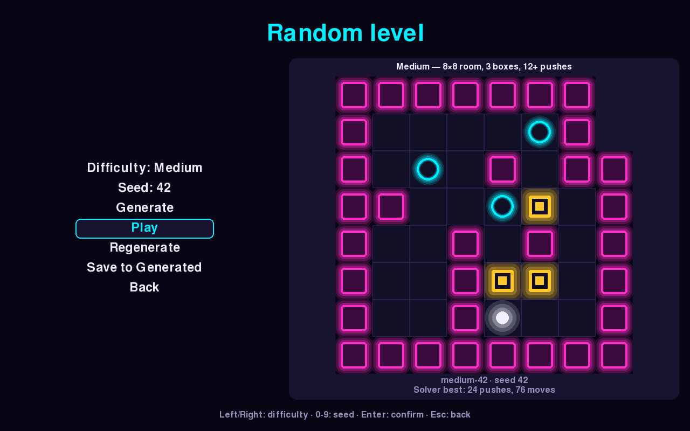
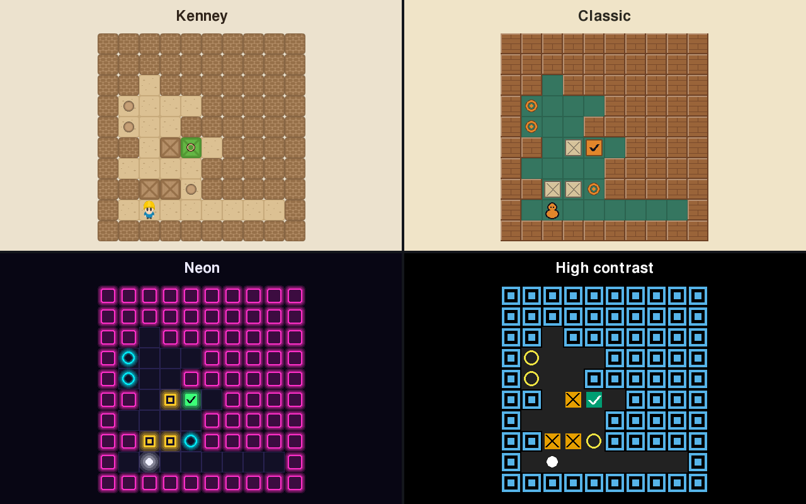
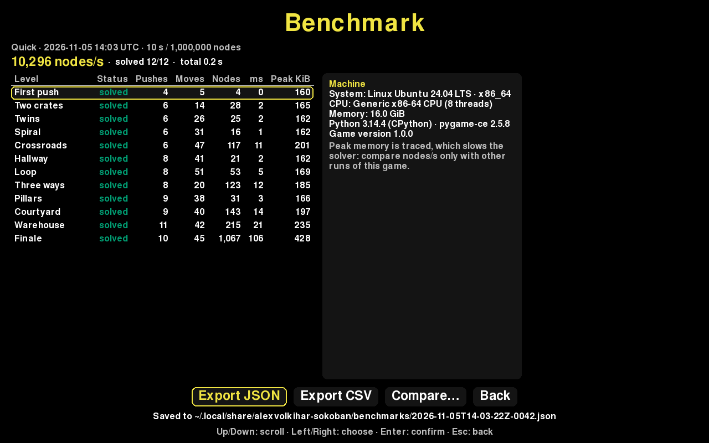
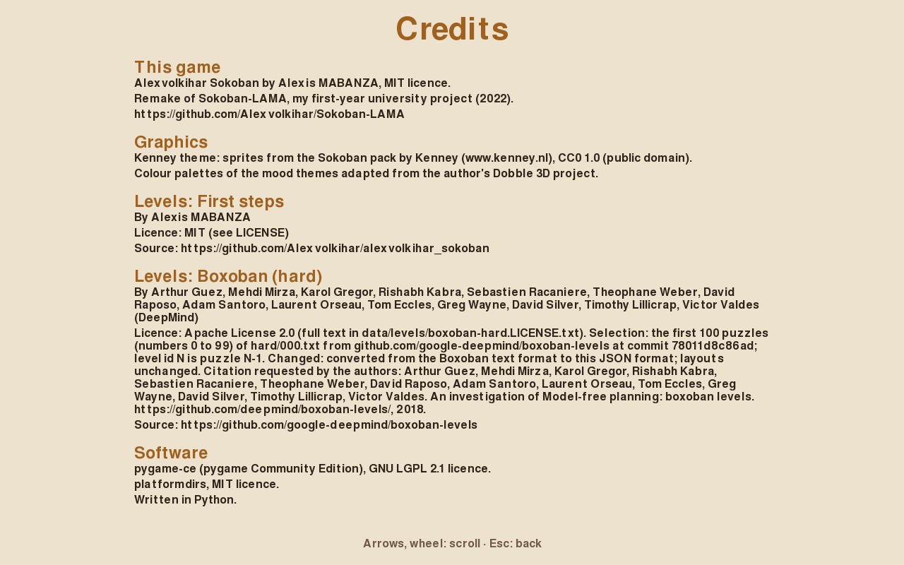

# Alexvolkihar Sokoban

*[English version](README.en.md)*

[](docs/media/demo.mp4)

<!--
Note pour le propriétaire du dépôt : pour avoir un lecteur vidéo intégré sur GitHub, ouvrir ce fichier dans
l'éditeur de github.com, glisser docs/media/demo.mp4 dans la zone de texte et coller ici l'URL
https://github.com/user-attachments/assets/... que GitHub génère (sur une ligne seule).
-->

[Vidéo de la démo (MP4, 30 s)](docs/media/demo.mp4)

Un Sokoban en Python et pygame-ce : on pousse des caisses sur des cibles, sans pouvoir les tirer. Le jeu
reprend Sokoban-LAMA, un projet étudiant de 2022, et en fait un jeu complet : menus, plus de 100 niveaux,
un solveur qui donne des indices et calcule le score de référence de chaque niveau, un générateur de
niveaux aléatoires, un mode benchmark pour comparer des machines, 20 thèmes, des sauvegardes et une
interface en français et en anglais.

Ce projet est le remake de
[Sokoban-LAMA](https://github.com/Alexvolkihar/Sokoban-LAMA), le projet de groupe de première année de
licence (L1) d'**Antoine LAROCHE, Alexis MABANZA, Logan VIVIEN et Martin PACARY (groupe LAMA)**. Le code
original est conservé tel quel dans [`legacy/`](legacy/). Les autres crédits sont en [fin de page](#crédits).

## Sommaire

- [Fonctionnalités](#fonctionnalités)
- [Installation](#installation)
- [Jouer](#jouer)
- [Niveaux](#niveaux)
- [Ligne de commande](#ligne-de-commande)
- [Benchmark](#benchmark)
- [Données et sauvegardes](#données-et-sauvegardes)
- [Formats et portage](#formats-et-portage)
- [Ce qui a changé depuis Sokoban-LAMA](#ce-qui-a-changé-depuis-sokoban-lama)
- [Développement](#développement)
- [Crédits](#crédits)
- [Licence](#licence)

## Fonctionnalités

Les captures sont en anglais ; l'interface suit la langue du système au premier lancement et se change
dans les paramètres.

| Menu principal | Sélection de niveau |
|---|---|
|  |  |
| **Continuer** reprend la partie en cours, coups compris. | Packs à gauche, miniatures, étoiles et meilleurs scores (coups/poussées) à droite. |

| Partie | Indice |
|---|---|
|  |  |
| Coups, poussées, temps et par (le score du solveur). Annulation et rétablissement illimités. | `H` calcule en arrière-plan la prochaine poussée d'une solution, ou signale une impasse. |

| Solution du solveur | Niveau aléatoire |
|---|---|
|  |  |
| Depuis la pause : lecture, pas à pas et vitesse réglable. | Trois difficultés, une graine reproductible ; chaque niveau est vérifié par le solveur. |



20 thèmes : les sprites Kenney du jeu original, `classic`, `neon`, `contrast` (palette Okabe-Ito et formes
distinctes : cibles en anneau, caisses barrées, coche sur une caisse placée, pour ne jamais dépendre de la
couleur seule) et 16 palettes d'ambiance. Le sélecteur montre un aperçu en direct.

| Benchmark | Crédits |
|---|---|
|  |  |
| Le solveur sur une série de niveaux : temps, nœuds, mémoire, export JSON/CSV, comparaison. | Auteurs, sources et licences de tout ce qui est fourni avec le jeu. |

Aussi : écran de victoire avec 1 à 3 étoiles, paramètres (langue, vitesse d'animation, chronomètre, plein
écran, remise à zéro), touches reconfigurables, fenêtre redimensionnable jusqu'à 640×480, le tout jouable
au clavier (la souris marche dans les menus).

## Installation

Il faut Python 3.11, 3.12, 3.13 ou 3.14. Les seules dépendances sont `pygame-ce` et `platformdirs` ;
pygame-ce publie des wheels pour Windows, macOS et Linux sur ces versions de Python, donc aucun compilateur
n'est nécessaire.

Avec [pipx](https://pipx.pypa.io/) (recommandé, le jeu a son propre environnement) :

```bash
pipx install git+https://github.com/Alexvolkihar/alexvolkihar_sokoban
alexvolkihar-sokoban
```

Depuis une [release GitHub](https://github.com/Alexvolkihar/alexvolkihar_sokoban/releases) : chaque version
publiée joint un wheel et une archive source. Télécharger le `.whl`, puis :

```bash
pipx install ./alexvolkihar_sokoban-1.0.0-py3-none-any.whl
```

Depuis les sources :

```bash
git clone https://github.com/Alexvolkihar/alexvolkihar_sokoban
cd alexvolkihar_sokoban
python -m venv .venv
source .venv/bin/activate        # Windows : .venv\Scripts\activate
pip install .
alexvolkihar-sokoban             # ou : python -m alexvolkihar_sokoban
```

pygame-ce s'importe sous le nom `pygame`, comme pygame. Si le paquet `pygame` est déjà installé dans le même
environnement, désinstallez-le d'abord (`pip uninstall pygame`) : les deux ne peuvent pas cohabiter.

## Jouer

`alexvolkihar-sokoban` sans argument ouvre le menu principal. `alexvolkihar-sokoban play FICHIER` lance
directement un niveau d'un fichier XSB, SOK, JSON ou au format LAMA d'origine.

| Action | Touches par défaut |
|---|---|
| Se déplacer | Flèches, ou WASD par position physique (ZQSD sur un clavier AZERTY) |
| Annuler | `U`, `Backspace`, `Ctrl+Z` |
| Rétablir | `Y`, `Ctrl+Y` |
| Recommencer | `R` deux fois en moins de 1,5 s |
| Indice | `H` |
| Pause | `Esc`, `P` |
| Valider | `Entrée`, `Espace` |
| Retour | `Esc` |

Toutes les touches se changent dans *Paramètres → Touches*. Pendant la lecture de la solution : `Entrée`
lecture/pause, `←`/`→` pas à pas, `↑`/`↓` vitesse.

Les étoiles se comparent au **par**, la solution que le solveur a trouvée avec le moins de poussées :
3 étoiles au par (poussées et coups), 2 étoiles jusqu'à 25 % de poussées en plus, 1 étoile sinon. Finir
avec moins de coups que le par donne un badge. Une partie où l'on a demandé un indice ou regardé la
solution compte comme terminée, sans étoiles ni record.

## Niveaux

| Pack | Contenu | Auteurs et licence |
|---|---|---|
| Sokoban-LAMA | les 11 niveaux de Sokoban-LAMA (`test1` à `test11`) | groupe LAMA, même licence que le code |
| Boxoban (difficile) | les 100 premiers niveaux de `hard/000.txt` (10×10, 4 caisses) | DeepMind, Apache-2.0 ([licence et citation](src/alexvolkihar_sokoban/data/levels/boxoban-hard.LICENSE.txt)) |
| Générés | les niveaux du générateur que vous avez joués ou enregistrés | les vôtres |
| Perso | les fichiers déposés dans `<dossier de données>/levels/` | les vôtres |

Pour ajouter vos niveaux, déposez des fichiers `.xsb`, `.sok`, `.txt` ou `.json` dans le dossier `levels/`
du [dossier de données](#données-et-sauvegardes) : ils apparaissent dans le pack *Perso*. Un fichier peut
contenir plusieurs niveaux ; un niveau invalide donne un avertissement, pas un plantage.

Microban (David W. Skinner) n'est pas fourni : sa licence demande de diffuser les niveaux sans modification,
ce qui exclut d'en retirer ceux empruntés à d'autres auteurs ou de les convertir. Les niveaux `test12` à
`test14` (insolubles exprès) et `test_performance` ne servent qu'aux tests et au benchmark.

## Ligne de commande

Toutes les commandes acceptent `--data-dir CHEMIN` (avant le nom de la commande) et `--help`.

```bash
# Ouvrir le menu, ou jouer directement un niveau d'un fichier
alexvolkihar-sokoban play
alexvolkihar-sokoban play mes-niveaux.sok --level 3

# Résoudre un niveau
alexvolkihar-sokoban solve legacy/level/test3.txt
alexvolkihar-sokoban solve pack.json --level 7 --time-limit 30 --max-nodes 2000000 --mode fast

# Convertir entre XSB/SOK, le format LAMA d'origine et JSON (format de sortie d'après l'extension)
alexvolkihar-sokoban convert legacy/level/test3.txt test3.xsb

# Calculer le par de chaque niveau d'un pack JSON (le fichier est réécrit)
alexvolkihar-sokoban annotate mon-pack.json --time-limit 60

# Lancer un benchmark, puis comparer deux résultats
alexvolkihar-sokoban bench --suite standard --csv resultats.csv
alexvolkihar-sokoban bench compare avant.json apres.json

# Générer un niveau reproductible (XSB sur la sortie standard, ou fichier avec --out)
alexvolkihar-sokoban generate --preset hard --seed 42 --out difficile-42.xsb
```

`solve` sort avec le code 0 si le niveau est résolu, 1 s'il est insoluble, 2 si le fichier est illisible ou le
niveau inconnu, 3 si une limite est atteinte. Exemple de sortie :

```text
level: test3/1
status: solved
pushes: 4
moves: 25
nodes: 8 expanded, 22 generated
time: 0 ms
lurd: LrdrddrddllllUUddrrrruulD
```

## Benchmark

Le benchmark fait résoudre une série de niveaux au solveur, un par un, et mesure pour chacun le résultat, les
poussées, les coups, les nœuds explorés, le temps et le pic de mémoire. Le chiffre principal est le nombre
de nœuds explorés par seconde.

| Série | Niveaux | Limites par niveau |
|---|---|---|
| `quick` | les 11 niveaux LAMA, quelques secondes | 10 s / 1 000 000 nœuds |
| `standard` | LAMA et les 40 premiers Boxoban | 30 s / 3 000 000 nœuds |
| `stress` | niveaux insolubles, `test_performance` réparé et les 100 Boxoban | 60 s / 5 000 000 nœuds (limites atteintes attendues) |

Il se lance depuis le menu *Benchmark* ou avec `alexvolkihar-sokoban bench`. Chaque résultat est enregistré
dans `<dossier de données>/benchmarks/` en JSON (et en CSV sur demande). `bench compare A B` affiche les
écarts de temps et de nœuds niveau par niveau et signale les changements de statut ; l'écran du jeu propose
la même comparaison.

Le pic de mémoire est mesuré avec `tracemalloc`, qui ralentit le solveur : comparez les nœuds/s entre
exécutions de ce jeu, pas avec d'autres programmes. Le résultat décrit la machine (système, processeur,
mémoire, versions de Python et de pygame-ce) mais ne contient ni nom de machine ni nom d'utilisateur, pour
pouvoir être partagé. Rien n'est envoyé nulle part.

## Données et sauvegardes

| Système | Dossier de données |
|---|---|
| Linux | `~/.local/share/alexvolkihar-sokoban` |
| macOS | `~/Library/Application Support/alexvolkihar-sokoban` |
| Windows | `%LOCALAPPDATA%\alexvolkihar-sokoban` |

La variable d'environnement `ALEXVOLKIHAR_SOKOBAN_HOME` ou l'option `--data-dir` le remplacent. On y trouve
`settings.json` (paramètres), `progress.json` (étoiles et records), `session.json` (partie en cours),
`generated.json` (niveaux générés), `levels/` (vos niveaux) et `benchmarks/`.

La partie en cours est enregistrée à la pause, en quittant et toutes les 10 s. La progression est rattachée
à une empreinte du niveau, pas à son nom : renommer ou réordonner un pack garde les scores. Les écritures
sont atomiques ; un fichier corrompu est renommé en `*.corrupt-<date>.json` et le jeu repart avec les
valeurs par défaut au lieu de planter.

## Formats et portage

Un remake sous Godot est prévu. Les règles du jeu et tous les fichiers (packs, paramètres, progression,
partie en cours, résultats de benchmark) sont décrits dans [`docs/formats.md`](docs/formats.md), avec des
schémas JSON dans [`schemas/`](schemas/) et des vecteurs de conformité dans
[`tests/vectors/`](tests/vectors/), pour qu'un portage relise les mêmes niveaux et les mêmes sauvegardes. Les
changements sont listés dans [`CHANGELOG.md`](CHANGELOG.md).

## Ce qui a changé depuis Sokoban-LAMA

Le jeu original (environ 545 lignes) lançait un seul niveau en ligne de commande. En le relisant :

- Son « A\* » n'en était pas un : la file de priorité retirait toujours le premier élément, la recherche
  était donc un parcours en largeur sur les déplacements, qui gardait le chemin complet dans chaque nœud et
  pouvait épuiser la mémoire. Le nouveau solveur est un A\* sur les poussées, avec détection d'impasses et
  limites de temps et de nœuds.
- Le plateau était dessiné transposé (lignes et colonnes inversées) ; la relecture de solution compensait en
  échangeant les directions. Il est maintenant dessiné dans le bon sens.
- Le `*` du format LAMA (une caisse) entrait en conflit avec le `*` du format XSB standard (une caisse sur
  une cible). Les deux formats sont maintenant lus chacun selon ses règles.
- `lvlultime` était une copie de `test8`, et `test_performance` (12 caisses, 14 cibles) était impossible à
  gagner ; il en existe une version réparée pour le benchmark. `wiki.txt` est le niveau 1 du Sokoban de
  Thinking Rabbit (1982), qui ne nous appartient pas : il reste seulement dans `legacy/`.
- Les images étaient rechargées à chaque déplacement et redimensionnées à chaque image ; le jeu les met
  maintenant en cache.

## Développement

```bash
python -m venv .venv
source .venv/bin/activate
pip install -e '.[dev]'
ruff check .
ruff format --check .
mypy
pytest -q
```

Les tests de l'interface tournent sans fenêtre (`SDL_VIDEODRIVER=dummy`, réglé par `tests/conftest.py`).
Seuls `ui/` et `commands/play.py` importent pygame ; Ruff et `tests/test_layering.py` le vérifient. La CI
GitHub Actions lance ces contrôles sur Linux (Python 3.11 à 3.14), Windows et macOS, puis construit et
teste le wheel.

Les captures et la vidéo de ce README sortent du jeu lui-même, sans fenêtre :

```bash
pip install -e '.[media]'
python scripts/capture.py --out docs/media
```

Le scénario des prises de vue est dans `scripts/storyboard.json`.

## Crédits

- **Sokoban-LAMA** (2022) : Antoine LAROCHE, Alexis MABANZA, Logan VIVIEN et Martin PACARY (groupe LAMA),
  <https://github.com/Alexvolkihar/Sokoban-LAMA>. Les motifs d'impasse de son solveur étaient crédités à
  KnightofLuna sur GitHub.
- **Ce remake** : Alexis MABANZA.
- **Sprites du thème Kenney** : pack « Sokoban » de [Kenney](https://www.kenney.nl), CC0 1.0 (domaine public).
- **Palettes des thèmes d'ambiance** : adaptées du projet Dobble 3D de l'auteur.
- **Niveaux Boxoban** : Arthur Guez, Mehdi Mirza, Karol Gregor, Rishabh Kabra, Sebastien Racaniere, Theophane
  Weber, David Raposo, Adam Santoro, Laurent Orseau, Tom Eccles, Greg Wayne, David Silver, Timothy Lillicrap
  et Victor Valdes (DeepMind), *An investigation of Model-free planning: boxoban levels*, 2018,
  <https://github.com/google-deepmind/boxoban-levels>, licence Apache-2.0.
- **Bibliothèques** : [pygame-ce](https://pyga.me/) (LGPL-2.1) et
  [platformdirs](https://github.com/tox-dev/platformdirs) (MIT).

## Licence

Pas encore de licence : elle attend l'accord des co-auteurs originaux. D'ici là, tous droits réservés. Les
sprites Kenney (CC0) et les niveaux Boxoban (Apache-2.0) gardent leur propre licence.
